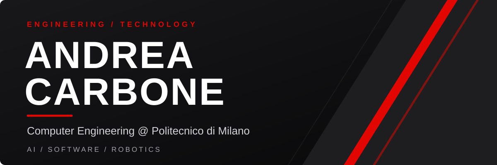

<!-- ====================================================== -->
<!-- HEADER -->
<!-- ====================================================== -->

  

<h3 align="center">
  Engineering ideas into reality.
</h3>

  Computer Engineering Student · Politecnico di Milano · Italy

 

<!-- ====================================================== -->
<!-- ABOUT ME -->
<!-- ====================================================== -->

## 01 / About me

I'm a Computer Engineering student at **Politecnico di Milano**, passionate about artificial intelligence, software engineering, robotics and the intersection between technology and design.

I enjoy turning ideas into functional systems, combining software, hardware and creative thinking.

- Based in Milan, Italy
- Interested in Artificial Intelligence and Robotics
- Exploring Human-Computer Interaction and Embedded Systems
- Always learning, experimenting and building new projects

 

<!-- ====================================================== -->
<!-- TECH STACK -->
<!-- ====================================================== -->

## 02 / Tech stack

### Programming languages

### Artificial Intelligence & Hardware

### Development tools

 

<!-- ====================================================== -->
<!-- SELECTED PROJECTS -->
<!-- ====================================================== -->

## 03 / Selected projects

### J.A.R.V.I.S.

A multimodal AI-powered personal assistant designed for macOS, inspired by the concept of intelligent human-computer interaction.

The project combines artificial intelligence, voice interaction, computer vision and desktop automation, with ongoing development focused on hardware integration.

**Key areas:**

- Large Language Models
- Speech recognition and text-to-speech
- Gesture recognition
- Computer vision and screen understanding
- Desktop automation
- Arduino and embedded systems integration

**Stack:** Python · PyQt6 · Groq · MediaPipe · Arduino

---

### Teach the Alien

An educational human-robot interaction project exploring how artificial intelligence and social robotics can support interactive learning experiences.

**Key areas:**

- Human-Robot Interaction
- User Experience Design
- Educational robotics
- Conversational AI
- Interactive prototyping

**Stack:** Python · Misty II · LLMs · Speech Technologies

---

### IS26-AM54

Software Engineering project developed at Politecnico di Milano, focused on collaborative software development and object-oriented architecture.

**Key areas:**

- Object-Oriented Programming
- Software architecture
- Design patterns
- Software testing
- Version control and team collaboration

**Stack:** Java · Maven · JUnit · Git

 

<!-- ====================================================== -->
<!-- CURRENT FOCUS -->
<!-- ====================================================== -->

## 04 / Current focus

| Area | Focus |
| :--- | :--- |
| Artificial Intelligence | Multimodal AI and intelligent assistants |
| Embedded Systems | Hardware-software integration with Arduino |
| Robotics | Human-robot interaction |
| Software Engineering | Scalable and maintainable architectures |
| Mobile Development | Interactive mobile applications |
| Creative Technology | Combining engineering, art and design |

 

<!-- ====================================================== -->
<!-- GITHUB ACTIVITY -->
<!-- ====================================================== -->

## 05 / GitHub activity

  
  

  

 

<!-- ====================================================== -->
<!-- FOOTER -->
<!-- ====================================================== -->

  

